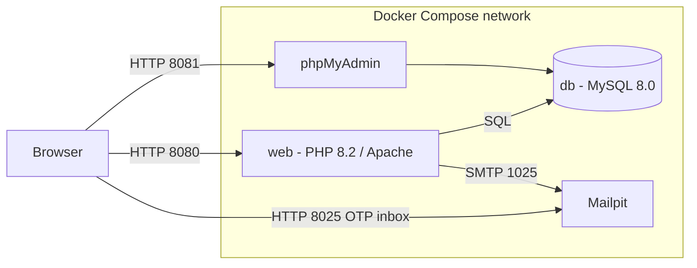

# MediVault: Hospital Patient Records Security System

MediVault is a web application that protects hospital patient records. Staff log in with a password plus a one-time code (OTP) sent by email, and what each person can do depends on their role. The system also tracks security assets, risks and incidents, keeps an activity log that flags suspicious behavior, and shows a security dashboard for administrators.

It was built for an Information Assurance and Security course and is deployed with **Docker** and managed with **Git/GitHub**.

> All data in this repository is fictional demo data. Never use real patient information.

## Features

- Login with password and emailed OTP
- Role-based access: admin, doctor, nurse and receptionist
- Account lock after repeated failed logins
- Activity log with automatic flagging of suspicious events (for example logins at unusual hours)
- Patient records, asset registry, risk assessment, incident management and security policies
- Soft delete, so records can be restored
- Forgot-password and reset flow with single-use, expiring tokens
- Admin dashboard with security status and charts

## Architecture



| Container | Service | Image | Purpose | Port |
|---|---|---|---|---|
| medivault-web | web | built from `Dockerfile` (php:8.2-apache) | PHP application | 8080 |
| medivault-db | db | mysql:8.0 | Database (not published to the host) | 3306 (internal) |
| medivault-phpmyadmin | phpmyadmin | phpmyadmin:5 | Database admin interface | 8081 |
| medivault-mail | mailpit | axllent/mailpit | Catches OTP and reset emails | 8025 |

## Tech stack

PHP 8.2 (Apache), MySQL 8.0, HTML, CSS, JavaScript, Bootstrap 5, Chart.js, PHPMailer, TCPDF, Docker, Docker Compose, Git and GitHub.

## Requirements

- [Docker Desktop](https://www.docker.com/products/docker-desktop/) (running)
- [Git](https://git-scm.com/downloads)

## Quick start

```
git clone https://github.com/pheterarot/MediVault.git
cd medivault
copy .env.example .env
```

On macOS or Linux use `cp .env.example .env` instead of `copy`.

Open `.env` in a text editor and set `DB_PASS` and `DB_ROOT_PASS` to passwords of your choice. The `.env` file is private and is never committed to GitHub. Then start the system:

```
docker compose up -d --build
docker compose ps
```

The first start takes about a minute because MySQL imports `database.sql`. Wait until `docker compose logs db` shows `ready for connections`, then open:

| What | URL |
|---|---|
| MediVault app | http://localhost:8080 |
| phpMyAdmin | http://localhost:8081 |
| Mailpit (OTP inbox) | http://localhost:8025 |

## Demo accounts

Every demo account uses the password **`Admin@1234`**.

| Role | Email |
|---|---|
| Admin | admin@example.com |
| Doctor | dr.santos@example.com |
| Doctor | dr.reyes@example.com |
| Nurse | nurse.delacruz@example.com |
| Nurse | nurse.tan@example.com |
| Receptionist | recep.ana@example.com |
| Receptionist | recep.ben@example.com |

**How to log in:**

1. Open http://localhost:8080 and enter an email and password.
2. The OTP is not sent to a real inbox. Open Mailpit at http://localhost:8025 and copy the 6-digit code from the newest email.
3. Enter the code to reach the dashboard.

Change these passwords before any real deployment.

## Useful commands

```
docker compose up -d --build   # build the web image and start everything
docker compose ps              # check container status
docker compose logs db         # read database logs
docker compose logs web        # read application logs
docker compose down            # stop containers and keep the data
docker compose down -v         # stop containers and DELETE the database volume
```

After you change any PHP file, run `docker compose up -d --build` again, because the code is copied into the image when it is built.

## Resetting the database

MySQL runs `database.sql` only when its data volume is empty. If you change `database.sql`, or the schema in your database is out of date, recreate the volume:

```
docker compose down -v
docker compose up -d --build
```

This deletes all current data and reloads the demo data.

## Troubleshooting

| Problem | Cause and fix |
|---|---|
| `Unknown column 'deleted_at'` (HTTP 500 on the dashboard) | The database was created from an older `database.sql`. Run `docker compose down -v`, then `docker compose up -d --build`. |
| Warnings that `DB_PASS` or `DB_ROOT_PASS` is not set, or the database container exits | The `.env` file is missing. Run `copy .env.example .env` and fill in the passwords. |
| `Can't connect to local MySQL server through socket` | The database is still starting or importing. Wait a minute and check `docker compose logs db`. |
| `Access denied for user` | The volume was created with different passwords than `.env` now has. Run `docker compose down -v` and start again. |
| `port is already allocated` | Another program uses port 8080, 8081 or 8025 (XAMPP's Apache is a common one). Stop it or change the port in `docker-compose.yml`. |
| `failed to connect to the docker API` | Docker Desktop is not running. Start it and wait for "Engine running". |
| No OTP email | Open http://localhost:8025. Emails are caught by Mailpit and never go to a real inbox. |

## Project structure

```
medivault/
├── Dockerfile
├── docker-compose.yml
├── .env.example            copy to .env and set passwords (.env is not committed)
├── .gitignore
├── .dockerignore
├── .htaccess               Apache security headers and rules
├── database.sql            schema and demo data
├── README.md
├── includes/
│   ├── db.php              database connection
│   ├── auth.php            authentication and role checks
│   ├── mailer.php          sends OTP and reset emails
│   └── config.production.example.php
├── src/                    PHPMailer library
├── tcpdf/                  TCPDF library
├── assets/images/
├── index.php               login page
├── verify.php              OTP verification
├── forgot_password.php
├── reset_password.php
├── change_password.php
├── logout.php
├── 404.php
├── dashboard.php
├── patients.php
├── assets.php
├── risks.php
├── incidents.php
├── logs.php
├── audit.php
├── users.php
└── policy.php
```

## Git workflow

| Branch | Purpose |
|---|---|
| `main` | Stable, demo-ready code. Updated only by merging `develop`. |
| `develop` | Integration branch for tested features. |
| `feature/*` | One branch per feature, for example `feature/dashboard`. |
| `fix/*` | Bug fixes. |

1. Create a branch from `develop`: `git checkout develop`, `git pull`, `git checkout -b feature/your-task`
2. Commit with a short prefix: `feat:`, `fix:`, `docs:` or `chore:`
3. Push the branch and open a pull request into `develop`
4. After review, merge, then rebuild and test with Docker
5. When `develop` is stable, open a pull request into `main` and tag the release (`git tag v1.0`)

## Team

lory jane buned, mike gino martinez, justin agad, al jasser maliga. 
